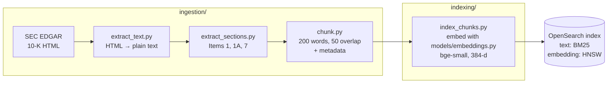
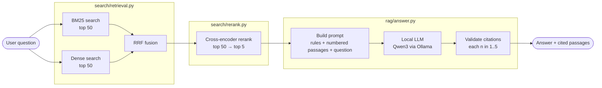
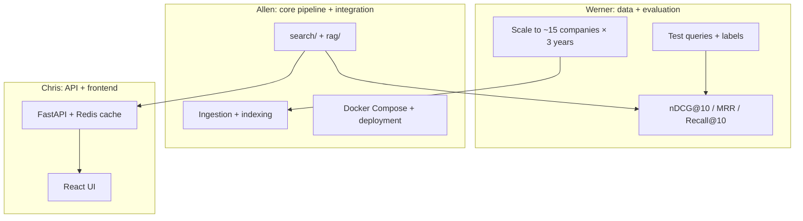

<div align="center">

# 🔎 FinSearch

**Search and cited Q&A over healthcare-sector SEC 10-K filings**


IS2140 (Information Retrieval) term project · Allen Liu, Chris Thornton, Werner Hager

</div>

---

SEC EDGAR's full-text search only matches keywords and returns whole 100+ page filings.
FinSearch splits filings into passages and finds the passages that answer a natural-language
question, using **BM25**, **dense (semantic) retrieval**, **hybrid fusion**, and **cross-encoder reranking**.
A **RAG** layer then writes a short answer that cites the passages it used.

## ✨ Example

```text
$ python -m rag.answer "Why did medical costs increase in 2023?"

===== Answer =====
The medical costs increased in 2023 primarily due to increased care patterns, particularly
related to outpatient procedures for seniors, which were observed during 2023 and are expected
to persist throughout 2024, potentially continuing in future periods [3].

===== Cited passages =====
[3] UNH_2023_Item7_004 | Medicaid margin percentages. We continue to take a prudent, market-sustainable p
Invalid citations: none
Generation time: 11.8s
```

A question the filings can't answer is declined instead of invented:

```text
$ python -m rag.answer "What was Apple's revenue in 2023?"

===== Answer =====
I couldn't find this in the filings.
```

---

## 📊 Status

| Part | Status | Owner |
|---|---|---|
| Ingestion: download, text extraction, section extraction, chunking | ✅ Done (1 filing: UnitedHealth FY2023) | Allen |
| Indexing: BM25 + dense vectors in OpenSearch | ✅ Done | Allen |
| Retrieval: BM25, dense, hybrid (RRF) | ✅ Done | Allen |
| Reranking: cross-encoder | ✅ Done | Allen |
| RAG: cited answers with a local LLM | ✅ Done (first version) | Allen |
| Scale data to ~15 companies × 3 years | ⬜ To do | Werner |
| Evaluation: test queries, relevance labels, nDCG@10 / MRR | ⬜ To do | Werner |
| API (FastAPI) + Redis cache | ⬜ To do | Chris |
| Frontend (React) | ⬜ To do | Chris |
| Docker Compose for the whole system, deployment | ⬜ To do | Allen |

---

## 🏗️ System architecture

### Offline: turn filings into searchable passages



### Online: answer a question



### Who owns what



---

## 🔍 Retrieval methods

| Method | How it ranks | Good at | Weak at | Code |
|---|---|---|---|---|
| BM25 (baseline) | Word matches, rare words count more, shorter passages score higher | Exact terms: drug names, codes, numbers | Synonyms ("rose" vs "increase") | `search.retrieval.bm25_search` |
| Dense | Cosine similarity of query and passage vectors | Same meaning, different words | Rare proper nouns | `search.retrieval.vector_search` |
| Hybrid | Reciprocal Rank Fusion of the two lists: score = Σ 1 / (60 + rank) | Gets both kinds of match | Runs two searches | `search.retrieval.hybrid_search` |
| Hybrid + rerank | Cross-encoder reads question and passage together, rescores top 50 | Precision in the top 5 | Slower, can't run over the whole index | `search.rerank.search_with_rerank` |

> [!NOTE]
> **Why RRF and not adding scores:** BM25 scores are unbounded (5, 14, 20…) while cosine scores
> are 0–1, so adding them lets BM25 dominate. RRF uses only ranks.

---

## 🧭 Design decisions

> [!IMPORTANT]
> These are settled. Please don't change them without raising it with the team first, because
> other parts (labels, cached results, the API) depend on them.

| Area | Decision | Reason |
|---|---|---|
| Sections | Items 1 (Business), 1A (Risk Factors), 7 (MD&A) | Cover business, risk, and performance questions; skip TOC and financial-table noise |
| Section finding | Regex on uppercase headings (`^ITEM\s+7\.`), fail loudly if not found | Simple, transparent, shows which filing broke |
| Chunking | 200 words, 50-word overlap | One complete idea per passage; overlap keeps cut sentences whole |
| Text analyzer | OpenSearch `english` (lowercase, stemming, stopwords) | "costs" matches "cost" |
| Query matching | BM25 `match`, OR | Natural-language questions contain words passages don't use |
| Embedding model | `BAAI/bge-small-en-v1.5`, 384-d, normalized; query prefix `"Represent this sentence for searching relevant passages: "` | 512-token limit fits our chunks; fast on CPU |
| Vector index | `knn_vector`, HNSW, cosine, lucene engine | Standard; supports filters |
| Fusion | RRF, k = 60, 50 candidates per side | Scores are on different scales |
| Reranker | `cross-encoder/ms-marco-MiniLM-L-6-v2`, top 50 → top 5 | Fast on CPU |
| LLM | Qwen3 via Ollama (local, free); call isolated in `rag.answer.call_llm` | No API cost; changing provider only changes one function |
| Generation | `temperature=0`, max 500 tokens, thinking off | Reproducible answers for evaluation |
| Citations | LLM cites `[n]`; code checks n is in range | Catches citations to passages that don't exist |

---

## 📁 Project structure

Folders follow the pipeline stages in the diagrams above.

```
finsearch/
├── config.py                # Shared settings: data paths, OpenSearch client, index name, model names
├── docker-compose.yml       # OpenSearch + Dashboards (more services added later)
├── requirements.txt
├── CLAUDE.md                # Context for Claude Code
│
├── ingestion/               # Offline 1: filing → passages
│   ├── download.py          #   Download a 10-K from SEC EDGAR
│   ├── extract_text.py      #   HTML → plain text
│   ├── extract_sections.py  #   Plain text → Items 1, 1A, 7
│   └── chunk.py             #   Sections → passage records (JSON)
│
├── indexing/                # Offline 2: passages → OpenSearch
│   ├── create_index.py      #   Create the index and mapping
│   └── index_chunks.py      #   Embed passages and bulk-write them
│
├── models/                  # Load a model and encode; no ranking logic
│   ├── embeddings.py        #   Bi-encoder (bge-small): embed_passages / embed_query
│   └── cross_encoder.py     #   Cross-encoder (ms-marco-MiniLM): score_pairs
│
├── search/                  # Online: rank passages for a query
│   ├── retrieval.py         #   bm25_search / vector_search / hybrid_search
│   └── rerank.py            #   rerank / search_with_rerank
│
├── rag/
│   └── answer.py            # Retrieve → prompt → LLM → validate → return
│
├── api/                     # (Chris) FastAPI app + Redis cache
├── frontend/                # (Chris) React app
├── evaluation/              # (Werner) queries, labels, metrics
│
├── results/                 # Saved runs (demo output, evaluation numbers)
└── data/                    # Generated
    ├── raw/                 #   Downloaded HTML
    ├── text/                #   Plain text and extracted sections
    └── chunks/              #   Passage records
```

> [!TIP]
> Run every script **as a module from the project root**: `python -m search.rerank "..."`, not
> `python search/rerank.py`. The `-m` form is what lets `from config import ...` and
> `from models.embeddings import ...` resolve.

---

## 🚀 Setup

### 1. Prerequisites

- Docker Desktop (running)
- Python 3.11+
- [Ollama](https://ollama.com) for the RAG step

### 2. Install

```bash
git clone https://github.com/Allen11204/finsearch.git
cd finsearch
python -m venv venv
source venv/bin/activate          # Windows: venv\Scripts\activate
pip install -r requirements.txt
```

### 3. Start OpenSearch

```bash
docker compose up -d
docker compose ps                 # both containers should show "Up"
```

- OpenSearch: http://localhost:9200
- Dashboards (Dev Tools for raw queries): http://localhost:5601

### 4. Start the LLM (only needed for `rag/answer.py`)

```bash
ollama serve                      # keep this running in its own terminal
ollama pull qwen3:8b              # ~5GB; use qwen3:4b on a Mac with 8GB RAM
```

### 5. Build the index

Run in order. The first run downloads the embedding model.

```bash
python -m ingestion.download
python -m ingestion.extract_text
python -m ingestion.extract_sections
python -m ingestion.chunk
python -m indexing.create_index       # deletes and recreates the index
python -m indexing.index_chunks       # embeds and writes all passages
```

> [!NOTE]
> The scripts currently process one filing (UnitedHealth FY2023); file names and company info
> are set at the top of each `ingestion/` script, folders in `config.py`. Scaling to many filings is the next ingestion task.

### 6. Try it

```bash
python -m search.retrieval "medical cost trend increase"          # BM25 vs dense vs hybrid
python -m search.rerank "Did medical costs increase in 2023?"     # hybrid top 5 vs reranked top 5
python -m rag.answer "Why did medical costs increase in 2023?"    # cited answer
```

A question whose answer isn't in the data (e.g. `"What was Apple's revenue in 2023?"`) should
return "I couldn't find this in the filings."

---

## 📐 Data contracts

These formats connect the modules. Keep them stable so everyone can work in parallel.

<details>
<summary><b>Passage record</b> (ingestion → index)</summary>

```json
{
  "id": "UNH_2023_Item7_033",
  "company": "UnitedHealth",
  "ticker": "UNH",
  "year": 2023,
  "section": "Item 7",
  "text": "…200 words…"
}
```

`id` = `{TICKER}_{YEAR}_{Section without space}_{3-digit chunk number}`.

> [!WARNING]
> Evaluation labels refer to these ids, so **ids change if chunking changes**. Finalize chunking before labeling.

</details>

<details>
<summary><b>Search result</b> (search functions → API → frontend)</summary>

```json
{
  "query": "medical cost trend",
  "method": "hybrid",
  "results": [
    {"id": "UNH_2023_Item7_033", "company": "UnitedHealth", "year": 2023,
     "section": "Item 7", "score": 0.0328, "text": "…"}
  ]
}
```

`method` is one of `bm25`, `dense`, `hybrid`, `rerank`.

</details>

<details>
<summary><b>RAG answer</b> (rag/answer.py → API → frontend)</summary>

```json
{
  "question": "Why did medical costs increase in 2023?",
  "answer": "Medical costs rose mainly because … [3].",
  "citations": [{"id": "UNH_2023_Item7_004", "section": "Item 7", "text": "…"}],
  "invalid_citations": []
}
```

</details>

<details>
<summary><b>Evaluation query</b> (evaluation)</summary>

```json
{"qid": "q01",
 "question": "Why did UnitedHealth's medical costs rise in 2023?",
 "type": "natural",
 "relevant_ids": ["UNH_2023_Item7_033", "UNH_2023_Item7_004"]}
```

`type`: `terminology` (uses filing wording), `natural` (everyday wording), or `unanswerable`.

</details>

---

## 🗺️ Work plan

### Werner: scale data + evaluation

- [ ] Pick ~15 healthcare, pharma, and insurance companies × 3 fiscal years; batch-download through
      the EDGAR submissions API (set a `User-Agent` with name and email; stay under 10 requests/s)
- [ ] Generalize the scripts to loop over filings; add regex rules where section headings differ.
      Flag sections shorter than 1,000 characters for manual review
- [ ] Move embedding into its own step (e.g. `indexing/embed.py` → `chunks_embedded.json`) so re-indexing doesn't re-embed
- [ ] Write 30–50 test questions mixing the three types above
- [ ] Label relevant passages with an LLM judge over the pooled top 10 of all methods; hand-check
      ~20 labels and report agreement
- [ ] Compute nDCG@10, MRR, Recall@10 for BM25, dense, hybrid, hybrid + rerank. Optional extras:
      chunk size 200 vs 400, citation faithfulness (does each cited passage support its sentence)

### Chris: API + cache + frontend

- [ ] FastAPI in `api/`:
  - `GET /search?q=&method=&company=&year=&section=&size=` → search result JSON
  - `POST /ask {"question": …}` → RAG answer JSON
  - Call the existing functions in `search/retrieval.py`, `search/rerank.py`, `rag/answer.py`; don't reimplement retrieval
- [ ] Redis cache in the API: key = method + normalized query + filters; cache RAG answers and
      reranked results; record latency with and without cache
- [ ] React in `frontend/`: search box, method switch, company/year/section filters, result list
      with section labels, answer view with clickable citations. Start with mock JSON from the
      contracts above

### Allen: system integration + deployment

- [ ] Docker Compose for the full system (OpenSearch, Redis, API, frontend; Ollama on the host)
- [ ] One-command startup and setup docs
- [ ] Deployment (target to be confirmed with the instructor)

### Timeline

| By | Milestone |
|---|---|
| TBD | Team meeting: confirm owners and contracts |
| TBD | Data scaled, chunking frozen |
| TBD | API + frontend working against real data |
| TBD | Evaluation results |
| TBD | Full system in Docker Compose; final presentation |

---

## 🤝 Working together

- Branch per task (`werner/scale-data`, `chris/api`), open a PR into `main`, one teammate reviews.
- Never commit `data/`, `venv/`, `.env`, or model files.
- Changing a decision in **Design decisions** or a format in **Data contracts**: post in the group
  chat first.
- Add new dependencies to `requirements.txt` in the same PR.

---

## ⚠️ Known issues

- One RAG answer cited a passage number that exists but doesn't support the sentence. The current
  check only verifies the number is in range; faithfulness is checked in evaluation.
- Section regex is tuned on UnitedHealth; other filings may use different heading formats.
- Adjacent overlapping chunks (e.g. `_032`, `_033`, `_034`) often appear together in the top results.
- `ollama serve` must be running before `rag/answer.py`; the first LLM answer takes ~10–25 s on a laptop.
